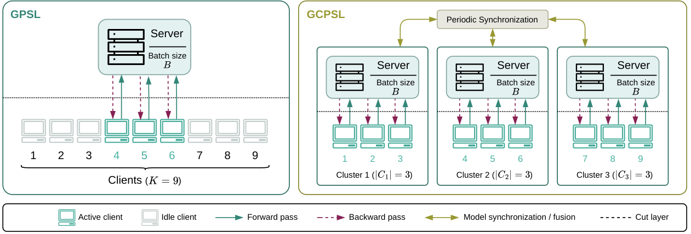
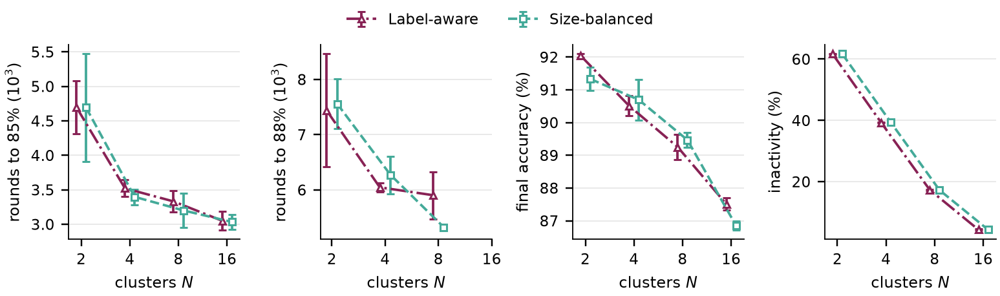

# GCPSL: Global Clustered Parallel Split Learning

[](https://arxiv.org/abs/2609.29395)
[](LICENSE)
[](pyproject.toml)

Official code for *Reducing Fixed-Batch Client Idleness in Many-Client Edge Split Learning*.

Parallel split learning with global sampling (GPSL) trains a split model on a fixed-size
batch drawn from the data of all clients.  When there are many more clients than batch
examples, most clients contribute no data in a round, however many servers are available.
GCPSL assigns clients to stable clusters, runs one GPSL workload per cluster concurrently,
and fuses the split-model replicas after every epoch.

<p align="center">
  
</p>

## Results

CIFAR-10, split ResNet-18 ([no skip connections in the client segment](docs/implementation_notes.md#split-model)),
256 clients with two classes each, four H100 GPUs, means over three paired runs.  t85 is the wall-clock time to 85% validation accuracy.

| Method | GPUs | t85 (min) ↓ | t88 (min) ↓ | Test acc. (%) ↑ | Participation (%) ↑ |
|---|---:|---:|---:|---:|---:|
| **GCPSL, random clusters** | 4 | **5.66** | **10.07** | 89.69 | 56.96 |
| **GCPSL, size-balanced clusters** | 4 | 5.70 | 10.20 | 89.32 | **60.21** |
| **GCPSL, label-aware clusters** | 4 | 6.13 | 11.30 | 89.53 | 59.43 |
| GPSL, sharded synchronous | 4 | 8.95 | 16.85 | 88.79 | 21.70 |
| GPSL, data-parallel | 4 | 5.69 | 19.53 | 88.21 | 60.11 |
| GPSL, repartitioned periodic | 4 | 5.84 | 10.31 | **89.95** | 57.12 |
| GPSL, single-worker | 1 | 10.88 | 23.28 | 89.59 | 21.70 |
| GPSL, larger-batch | 1 | 11.45 | 35.45 | 89.08 | 60.11 |

Random and size-balanced GCPSL match the fastest baseline at 85% and reach 88% in about half
the time of data-parallel GPSL, while synchronizing across GPUs once per epoch.  With more
clusters, participation rises and 85% is reached in fewer rounds, but each workload sees fewer
clients: final accuracy falls, and N=16 misses the 88% target.

<p align="center">
  
</p>

The table was measured on four H100 GPUs with the research implementation of this code.  See
[what is reproduced](docs/reproduction.md#what-is-reproduced).

## Setup

```bash
pip install -c requirements.lock -e ".[dev,analysis]"   # lock file: Python 3.11, Linux, CUDA 12.4
export PYTHONHASHSEED=0                                 # required by all training commands
pytest -q                                               # CPU only, several minutes
```

or build the container, which pins PyTorch 2.6.0 and CUDA 12.4:

```bash
docker build -t gcpsl .
docker run --gpus all --ipc=host -v /path/to/data:/data -v "$PWD/outputs:/app/outputs" gcpsl \
  torchrun --standalone --nproc-per-node 4 train_distributed.py \
    --config-name gcpsl_size_balanced data_dir=/data
```

CIFAR-10 and CIFAR-100 are read from `data_dir` in torchvision format; add `download=true`
to fetch them.  The container sets `PYTHONHASHSEED`; set `strict_determinism=false` to run without it.

## Real-execution study

One process per GPU, PyTorch Distributed with NCCL.  Every configuration in
[`configs/distributed`](configs/distributed) is one method of the paper.

```bash
# GCPSL and the four-GPU baselines
torchrun --standalone --nproc-per-node 4 train_distributed.py \
  --config-name gcpsl_size_balanced seed=40 data_dir=/path/to/data

# single-GPU baselines
torchrun --standalone --nproc-per-node 1 train_distributed.py \
  --config-name gpsl_single_worker seed=40 data_dir=/path/to/data
```

| Config | Method |
|---|---|
| `gcpsl_random`, `gcpsl_size_balanced`, `gcpsl_label_aware` | GCPSL with the three assignment rules |
| `gcpsl_label_aware_sequential` | the same workloads executed in turn |
| `gpsl_single_worker`, `gpsl_larger_batch` | GPSL on one GPU with B=64 and B=256 |
| `gpsl_sharded_sync`, `gpsl_data_parallel` | per-step synchronized GPSL on four GPUs |
| `gpsl_repartitioned` | four workloads, clients reassigned at every fusion |

The paper uses seeds 40, 72 and 313.  Results are written to
`outputs/distributed/<config>/seed<seed>/summary.json`.

## Schedule-accounted studies

A single process trains all cluster workloads and counts time in schedule rounds.

```bash
python train_schedule_accounted.py --config-name cifar10_b64_label_aware_n8 seed=40 data_dir=/path/to/data
```

[`configs/schedule_accounted`](configs/schedule_accounted) contains the cluster-count sweep,
the batch-size and capacity controls, the fusion controls, and CIFAR-100.

## Tables and figures

```bash
python analysis/tables.py                     # all result tables
python analysis/figures.py --output figures   # all result figures
```

Both read the released per-run data in [`results/`](results), described in
[`docs/results_data.md`](docs/results_data.md).  New runs write a `summary.json` of their own.

## Documentation

- [Reproduction](docs/reproduction.md): commands, run times, what was verified
- [Implementation notes](docs/implementation_notes.md): properties of the code that matter when
  interpreting the results, including the split model and the accuracy metric
- [Results data](docs/results_data.md): column definitions

## Repository layout

```text
configs/
├── distributed/            # real-execution study, one file per table row
└── schedule_accounted/     # schedule-accounted studies
src/gcpsl/
├── clustering.py           # random, size-balanced and label-aware assignment
├── sampling.py             # GPSL global sampler and epoch schedules
├── step.py                 # one GPSL training step
├── fusion.py               # sample-weighted fusion
├── normalization.py        # synchronized BatchNorm for the synchronous baselines
├── data/                   # CIFAR, augmentation, client partition
├── models/                 # split ResNet-18
├── distributed/            # multi-process engine
└── schedule_accounted/     # single-process trainer
analysis/                   # tables and figures from results/
results/                    # per-run data of the paper
tests/
```

## Citation

```bibtex
@misc{kohankhaki2026gcpsl,
  title         = {Reducing Fixed-Batch Client Idleness in Many-Client Edge Split Learning},
  author        = {Kohankhaki, Mohammad and Rentschler, Valentin and Kamp, Carsten and Brell-Cokcan, Sigrid and Schmeink, Anke},
  year          = {2026},
  eprint        = {2609.29395},
  archivePrefix = {arXiv},
  primaryClass  = {cs.DC},
}
```

GCPSL builds on [GPSL](https://github.com/mohkoh19/gpsl):

```bibtex
@inproceedings{kohankhaki2025gpsl,
  title     = {Parallel Split Learning with Global Sampling},
  author    = {Kohankhaki, Mohammad and Ayad, Ahmad and Barhoush, Mahdi and Schmeink, Anke},
  booktitle = {International Conference on Foundation and Large Language Models (FLLM)},
  pages     = {281--288},
  year      = {2025},
  doi       = {10.1109/FLLM67465.2025.11391108},
}
```

## License

Released under [CC BY-NC 4.0](LICENSE): research and other non-commercial use with attribution.
The model is based on the torchvision ResNet (BSD 3-Clause).
